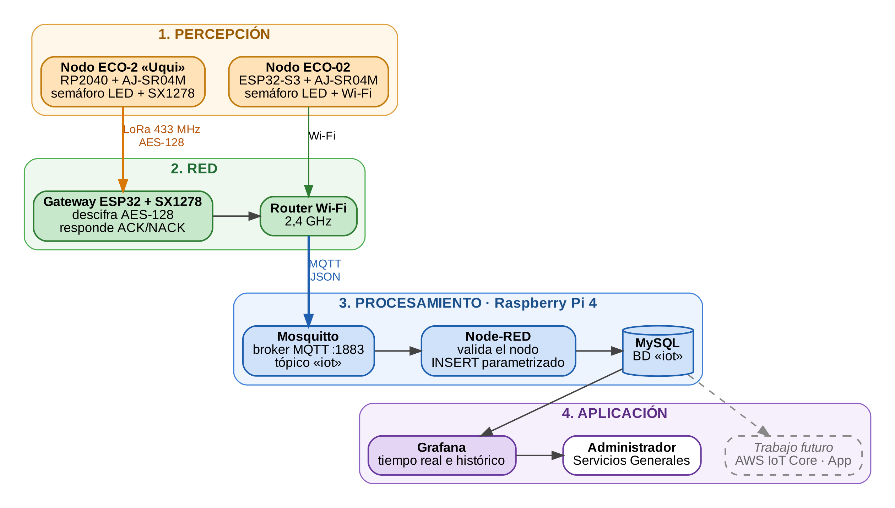

# EcoSmart UCO — Red IoT de monitoreo de puntos ecológicos

<p align="center"></p>

Red de sensores IoT que mide el **nivel de llenado de los puntos ecológicos** de la Universidad Católica de Oriente (UCO), lo muestra con un semáforo de LED en el propio punto y lo publica en una plataforma local para su consulta en tiempo real e histórica.

Proyecto Integrador · **Internet de las Cosas** · Grupo 02 · 2026-2 · Docente: Juan Camilo Acevedo Bedoya
Equipo: Johan Steven Ochoa · Wendy Daniela Alzate · José Manuel Pavas

> **Versión entregada:** v1.1 (noviembre de 2026). Ver [`docs/CAMBIOS_v1.1.md`](docs/CAMBIOS_v1.1.md).

---

## Arquitectura



```
Nodo ECO-2 (RP2040 + AJ-SR04M + semáforo, dentro de «Uki»)
   │  LoRa 433 MHz · JSON cifrado AES-128 · ACK/NACK
   ▼
Gateway ESP32 + SX1278  ──Wi-Fi / MQTT (tópico «iot»)──►  Raspberry Pi 4
                                                           ├─ Mosquitto (broker)
Nodo ECO-02 (ESP32-S3 + AJ-SR04M + semáforo) ──Wi-Fi──►   ├─ Node-RED (valida el nodo, INSERT parametrizado)
                                                           ├─ MySQL / MariaDB (BD «iot», tabla «valores»)
                                                           └─ Grafana (dashboard)
```

| Capa | Componentes |
|---|---|
| Percepción | Raspberry Pi Pico (RP2040), ESP32-S3, sensores ultrasónicos AJ-SR04M, semáforo de 3 LED |
| Red | LoRa SX1278 (433 MHz, BW 125 kHz), Wi-Fi 2,4 GHz, MQTT |
| Procesamiento | Raspberry Pi 4: Mosquitto, Node-RED, MySQL/MariaDB |
| Aplicación | Grafana |

### Calibración del semáforo

| Nivel | LED | Llenado | Distancia medida |
|---|---|---|---|
| Bajo | Verde | 0 a 50 % | más de 70 cm |
| Medio | Amarillo | 50 a 80 % | entre 40 y 70 cm |
| Alto | Rojo | más de 80 % | menos de 40 cm |

Sin lectura válida (zona ciega, checksum inválido o > 500 cm) → `LLENO _UMBRAL`, LED rojo.

---

## Estructura del repositorio

```
firmware/
  common/                   Librerías compartidas: lora_lib.py, jsn_sr04t.py, wifi.py
  rp2040/nodo_exterior/     Nodo ECO-2 (LoRa + AES-128 + semáforo) — main.py v1.1
  esp32/gateway_lora_mqtt/  Gateway LoRa → MQTT (descifra, publica, ACK/NACK) — main.py v1.1
    MQTT/ejemplo_wifi.py    ⚠ provisional (ver «Pendientes»)
  esp32/nodo_interior/      Nodo ECO-02 (Wi-Fi directo)
  _historico_sep2026/       Versiones anteriores (mensaje en texto plano y config.py)
servidor/
  nodered/flujo_ecosmart.json   Flujo de Node-RED (importar desde el menú → Import)
  mysql/esquema_referencia.sql  Base de datos y usuarios con permisos mínimos
gateway/                    Pruebas iniciales: mosquitto.conf y suscriptor en consola
tests/
  01_sensor … 05_leds_json  Pruebas incrementales en hardware
  06_simulacion_v1.1/       Pruebas del firmware en MicroPython con dobles de prueba (mocks)
docs/                       Documentos finales, diagramas, imágenes de Uki y registro de cambios
```

## Cómo cargar el firmware (Thonny)

| Dispositivo | Archivos a copiar en la raíz de la placa |
|---|---|
| Nodo ECO-2 (Pico) | `firmware/rp2040/nodo_exterior/main.py`, `firmware/common/lora_lib.py` |
| Gateway (ESP32) | `firmware/esp32/gateway_lora_mqtt/main.py`, la carpeta `MQTT/`, `firmware/common/lora_lib.py`, `firmware/common/wifi.py`, `secrets.py` |
| Nodo ECO-02 (ESP32-S3) | `firmware/esp32/nodo_interior/main.py` y `config.py`, `firmware/common/jsn_sr04t.py`, `firmware/common/wifi.py`, `secrets.py` |

Las credenciales Wi-Fi van en `secrets.py` (copiar `secrets_ejemplo.py`). **`secrets.py` está en `.gitignore` y nunca se sube.**

La instalación completa del servidor (Mosquitto, MariaDB, Node-RED y Grafana) está en `docs/ECO-MI-001_Manual_de_Instalacion.docx`.

## Pruebas del firmware (v1.1)

```bash
# Requiere MicroPython para PC (port Unix): ver docs/CAMBIOS_v1.1.md
cd tests/06_simulacion_v1.1
micropython test_nodo.py    ../../firmware/rp2040/nodo_exterior     mensajes.json   # esperado: 11/11
micropython test_gateway.py ../../firmware/esp32/gateway_lora_mqtt  mensajes.json   # esperado: 7/7
```

## Documentación

| Documento | Archivo |
|---|---|
| Documento técnico | `docs/ECO-DT-001_Documento_Tecnico.docx` |
| Manual de usuario | `docs/ECO-MU-001_Manual_de_Usuario.docx` |
| Manual técnico | `docs/ECO-MT-001_Manual_Tecnico.docx` |
| Manual de instalación | `docs/ECO-MI-001_Manual_de_Instalacion.docx` |
| Diagramas | `docs/diagramas/` |
| Registro de cambios y evidencia de pruebas | `docs/CAMBIOS_v1.1.md`, `docs/evidencia_pruebas.txt` |

## Pendientes conocidos

- [ ] Reemplazar `firmware/esp32/gateway_lora_mqtt/MQTT/ejemplo_wifi.py` (provisional) por el archivo original del equipo.
- [ ] Mover la clave AES del código a `secrets.py` (hoy está escrita en `main.py` del nodo y del gateway).
- [ ] Mejoras de seguridad documentadas en `docs/CAMBIOS_v1.1.md` §5.2 (AES-CBC + HMAC, autenticación MQTT, QoS).
- [ ] Integrar el nodo ECO-02 al flujo de Node-RED (tópico `iot` y campo `mac`).

## Uso de inteligencia artificial

Durante el desarrollo se usó Claude (Anthropic) como apoyo para la revisión de código, las pruebas en simulación, los diagramas, la documentación y la animación del video de Uki. El detalle está en la sección «Declaración de uso de inteligencia artificial» del Documento técnico.
